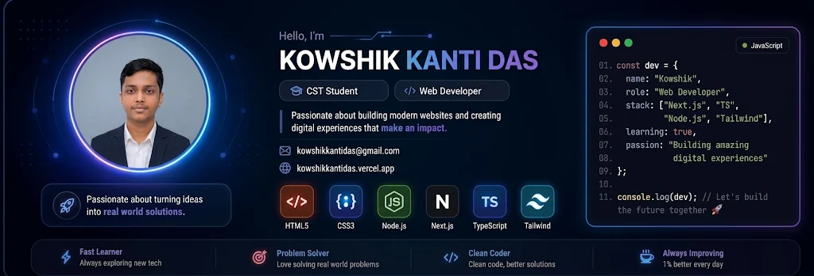

  

<h1 align="center">Hi 👋, I'm Kowshik Kanti Das</h1>

  

  
  

---

## 👨‍💻 About Me

I'm a **Web Developer** focused on **React, Next.js and Tailwind CSS**.

- 🎓 Diploma in **Computer Engineering** at **Bangladesh Sweden Polytechnic Institute (BSPI)**, Kaptai
- 🖥️ General Member, **BSPI Computer Club (BSPICC)**
- 📚 Learning web development through **Programming Hero**
- 🌱 Also exploring: **Digital Marketing (Meta Ads)** and **Cybersecurity** (Kali Linux lab on legal platforms like TryHackMe, HackTheBox)

---

## 🛠️ Tech Stack

**Frontend**

  

**Tools**

  

**Currently Learning**

  

**Also Exploring**

  
  
  
  

---

## 🚀 Projects

### ⭐ Featured

| Project | Description | Tech | Links |
|---|---|---|---|
| **StudioSpace** | Studio booking marketplace, live on Vercel | Next.js | [Live](https://studiospace-bd.vercel.app/) · [GitHub](https://github.com/Kowshikkantidasbd/StudioSpace) |
| **Bazar Dor** | Bengali market price tracking website for daily essentials | JavaScript | [Live](https://bazar-dor-cgzi.vercel.app/) · [GitHub](https://github.com/Kowshikkantidasbd/bazar-dor) |
| **Movie Explorer** | Movie browsing and discovery web app | React | [Live](https://movie-explorer-tau-eight.vercel.app/) · [GitHub](https://github.com/Kowshikkantidasbd/Movie-Explorer) |
| **FitLog** | Workout library | Next.js 14, Tailwind, daisyUI | [Live](https://fitlog-kowshik-ten.vercel.app/) · [GitHub](https://github.com/Kowshikkantidasbd/FITLOG) |

---

## 📊 GitHub Stats

  
  

---

## 🌐 Connect With Me

